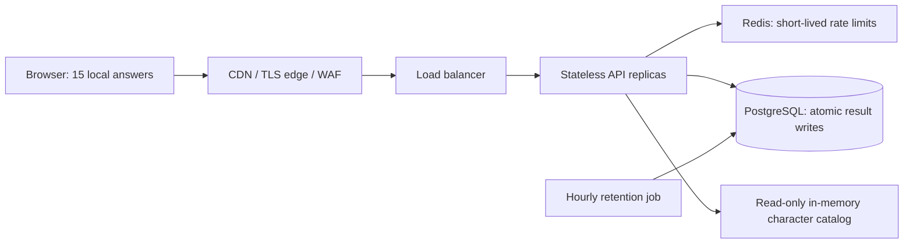

# MovieGame

A complete local movie-character game: 15 varied questions, five to eight options per question, three character matches, and five answer-linked explanations for the best match. No account or paid AI API is required.

**1,126 films / 2,282 character profiles:** 994 Hollywood, 45 Bangladeshi, 87 Japanese anime. This update adds 537 films; 1,111 films have two characters and 15 ensembles have four. Each entry includes a named character, identity, original description, themes, eight editorial trait scores, and a film reference. Each film has two or four selected characters, rather than an exhaustive cast. 118 film references were individually checked; 1,008 remain pending editorial verification. An additional cast review covered the original films, including the Bangladeshi entries. Film identities and links need further editorial review before a public commercial launch. Personality scores are interpretations for a game, not psychological facts.

## English and Bangla

Use **Language** at the far right of the navigation bar to choose English or বাংলা. The choice is remembered on this device. Surveys, catalog titles/roles/descriptions/themes, results, explanations, privacy text, and share graphics support both languages. Switching languages keeps the current answers and scores. The named eight-trait card appears at the top-right on desktop and first on small screens for easy screenshots.

Translations are bundled in `data/_bn_*.json`; no runtime translation service or external AI call is used. Canonical English data, stable IDs, scoring, survey editions, and saved results remain unchanged. New catalog entries need corresponding Bangla display records and theme labels. Longer film prose uses machine-assisted translations with editorial corrections; further language review can improve phrasing. Original reference artwork remains in its original language.

## Start on Windows

Use Python 3.14 and PowerShell in `E:\vscode-git\MovieGame`:

```powershell
.\setup.ps1
.\start.ps1
```

Open **http://localhost:8017**. `setup.ps1` installs dependencies and creates/populates `moviegame.db`. Local development uses SQLite. This is a real database populated from the bundled catalog; no API key or movie download is needed. If PowerShell blocks local scripts, run `powershell -ExecutionPolicy Bypass -File .\setup.ps1` and similarly for `start.ps1` for that invocation only.

On Linux/macOS: `python3 -m venv .venv`, activate it, `pip install -r requirements-dev.txt`, `python -m app.manage init`, then `uvicorn app.main:app --host 127.0.0.1 --port 8017`.

## Run the PostgreSQL / Redis / load-balancer stack

Start Docker Desktop's Linux engine, then:

```powershell
.\setup.ps1 -Compose
```

Open **http://localhost:8080**. The script creates random local secrets in ignored `.env`, then starts PostgreSQL, Redis, a one-time schema/seed job, two API replicas, Nginx, and hourly result cleanup. Persistent data lives in the `pgdata` volume. `docker compose down` stops the stack without deleting the database. **Do not use `down -v` unless you intend to erase it.** This Compose installation is a single-machine integration environment, not a highly available public deployment.

## What is implemented

- Responsive cinema-themed web app; category selection, back/next navigation, tab-local progress recovery, searchable/paginated character library, result sharing, keyboard-accessible choices and reduced-motion support.
- FastAPI server, normalized PostgreSQL-compatible catalog, immutable survey edition, transparent deterministic matching, and no external network calls in the matching path.
- Atomic idempotency: the browser sends a random UUID key; a database primary key makes concurrent retries converge to one stored result. Reusing a key with different answers returns 409. New results commit before success is returned. A retry after a lost response returns the saved result.
- Shared Redis rate limiter using one atomic Lua operation; outages reject submissions with 503. Local development uses a bounded in-process substitute. Readiness checks PostgreSQL/Redis; liveness only checks the process.
- Bounded connection pool, request concurrency, 8 KB body limit, slow-body timeout, statement/lock/connect timeouts, input validation, retry hints, private metrics, and no raw answers/IPs in application logs.
- Nginx least-connection balancing, passive upstream failover, compression, static serving, and public GET caching. Submissions and health checks are not cached. APIs are not published directly to the host.
- Container image, Compose, Kubernetes rolling deployment/HPA/disruption budget, hourly retention cleanup, CI with real PostgreSQL/Redis integration checks, and a k6 load test.

## Architecture and scale



The target is **1 crore = 10 million participants**, not a claim that this laptop or the supplied Compose stack can serve 10 million concurrent requests. Ten million completed surveys/day averages about 116 submissions/second; a 10× peak is about 1,160/second. A full user journey also requests static files, the survey, and optionally catalog pages. Measure the actual arrival pattern and size your infrastructure accordingly.

For a public launch, use a CDN and TLS edge, multi-zone managed PostgreSQL with backups/PITR and tested failover, managed Redis with failover, and multiple API instances. `deploy/kubernetes.yaml` provides 3–30 replicas; replace its image and create `moviegame-secrets`. Set the actual trusted ingress proxy CIDR so rate limiting sees the real client address. Without this, users can share the ingress rate bucket. Never trust arbitrary forwarded headers on a directly exposed API. The maximum pool budget is 30 replicas × 4 connections plus rollout/migration/cleanup headroom. Keep the aggregate below the database limit or use a properly tested external pooler.

Before applying the deployment, run `python -m app.manage init` once in a Job using the same image and secrets. The init job is explicit because schema writes must not race across replicas. Connect the internal Service to your existing TLS ingress/load balancer. Autoscaling needs Kubernetes Metrics Server and sufficient node capacity. The manifests are templates requiring your registry, hosting, ingress, and secrets; no cloud resources have been purchased or deployed.

Provision storage from measured row sizes, retention, WAL, indexes, and backup overhead; retained JSON results can reach tens to hundreds of GB at 10 million submissions. Monitor PostgreSQL write latency, connections, disk/WAL growth, Redis errors, 429/503 rates, p95/p99 latency, and HPA saturation. Retention deletes at most 100,000 rows per invocation in 1,000-row transactions. Increase cleanup frequency when arrival/expiry rates exceed that budget and monitor backlog. Keep autovacuum healthy; review time partitioning before retention traffic becomes a bottleneck.

No system can guarantee “never crashes.” This implementation limits overload and makes retries safe. Production capacity, dependency failover, recovery time, and SLOs must be validated on the actual deployment.

## Test and load-test

```powershell
New-Item -ItemType Directory -Force test-results | Out-Null
.\.venv\Scripts\python.exe -m pytest -q --basetemp=.\test-results\tmp
.\.venv\Scripts\python.exe -m app.manage validate
```

The optional cross-replica test requires **disposable** `TEST_DATABASE_URL` (PostgreSQL) and `TEST_REDIS_URL`. CI starts these services automatically. The test performs 32 concurrent same-key requests across two app instances, then checks conflicting reuse. The default suite uses temporary SQLite databases and includes concurrent duplicate requests, 15/5 survey validation, five grounded reasons, category filters, malformed inputs, rate limiting, body size, and simulated Redis failure.

With k6 installed, load-test your own disposable staging environment:

```powershell
$env:BASE_URL='http://localhost:8080'
$env:RATE='100'
$env:DURATION='5m'
k6 run loadtest/survey.js
```

The rate is **completed surveys/second**; 10% of iterations also replay. Raise `RATE_LIMIT_PER_MINUTE` for your isolated load generator, restart the staging APIs, and restore the normal setting afterward. Never bypass public rate controls with forged forwarding headers. Thresholds require <1% errors, submit p95 <500 ms, p99 <1.5 s, and no dropped iterations. These are test targets, not measured production promises. Ramp progressively, test spikes and sustained load, kill an API replica during traffic, interrupt Redis, exercise PostgreSQL failover, verify single-row retries, and restore a backup before production launch.

## Matching and data maintenance

Both survey modes draw 15 questions from separate 27-question banks, shuffle answer choices, and measure courage, empathy, curiosity, discipline, independence, sociability, creativity, and resilience. Scenario choices map to 0–4 intensity independently of their shuffled display order; per-trait means are normalized. Eight-trait similarity contributes 90% of the score and shared story-value signals from themes/roles contribute 10%. Two purpose/value questions help distinguish otherwise similar profiles. All eight personality traits receive equal weight within their part of the score. Character distance is root-mean-square difference, and affinity is `100 × (1 - distance)`. The five closest distinct traits provide explanations quoting actual choices; near-ties are disclosed with alternatives. Ties use a deterministic hash of answers and character ID. Top alternatives have distinct character names; sequels remain distinct films.

Edit source JSON in `data/`, run validation, review facts and reference links, then deploy a new catalog edition through a reviewed migration. Initialization refuses to silently replace a different existing catalog. For **local disposable data only**, choose a new SQLite `DATABASE_URL` to try a revised edition without overwriting the old database. Future production schema/catalog changes need explicit migrations; v2 is represented by `app/database.py` and generated `deploy/schema.sql`. Survey wording/scoring changes require a new `VERSION`. Each result records survey and catalog editions. Existing identical retries can return saved older-edition results until cleanup removes them.

Sources use earliest premiere/release dates where known; the Bangladeshi collection includes co-productions and pre-independence cinema from present-day Bangladesh. Anime entries are feature films, including a small number of television-premiered features, not series episodes. Movie images use 1,108 Wikimedia reference-artwork URLs; the other 18 films receive clearly labelled original cover art. Posters are not downloaded into the project. Scripts and copied plot summaries are not bundled. Referenced sources are not a license to reuse their media or full prose.

## Privacy and operations

No names, email addresses, accounts, or demographic profiling. Raw complete answer sets are not stored server-side; a SHA-256 request hash and result are stored. Results contain selected answer quotations needed for explanations, so treat them as user data. UUID submission keys are bearer-like secrets; do not log them. Do not put them in URLs. Replays last while the row is retained; after cleanup, reuse can create a new result. “Start over” clears the tab’s saved game, not the server record. Production cleanup is hourly in Compose/Kubernetes. Local SQLite retains results until `python -m app.manage prune` runs. Adjust the UI privacy wording if you change the retention policy. Shared-network rate limits can affect people behind carrier NAT; tune thresholds from real traffic and add edge bot controls as needed.

`GET /metrics` requires `Authorization: Bearer <METRICS_TOKEN>` and is blocked at the supplied public proxy. Scrape directly on the private network. APIs never expose lists of submissions. Explicit sharing creates an unlisted public result URL containing only the chosen display name, character identity, affinity, and eight trait bars; full answers and explanations remain private. Shared pages and PNG cards expire with the saved result, although copies on social platforms can outlive them. Use least-privilege database roles for API vs migrations in a managed production deployment, restrict database/Redis access to the private network, terminate TLS at your edge, and keep secrets out of version control.

## API

| Endpoint | Purpose |
|---|---|
| `GET /api/v1/survey?mode=story&seed=<UUID>` | Seeded 15-question variant, edition IDs, catalog counts; `mode=character` uses the separate Character Game bank |
| `GET /api/v1/catalog?q=&category=all&page=1&limit=12` | Search/browse; maximum page size 48 |
| `POST /api/v1/matches` | Submit the returned seed, mode, edition IDs, and exactly 15 question/option IDs; UUID `Idempotency-Key` required |
| `POST /api/v1/shares` | Explicitly create a public named bar-result snapshot from a saved result; same UUID key required |
| `GET /s/<token>` | Unlisted, expiring public result with Open Graph metadata |
| `GET /s/<token>/card.png` | Named result image with eight trait bars; `?download=1` downloads it |
| `GET /health/live` | Process liveness |
| `GET /health/ready` | Database + Redis readiness |
| `GET /metrics` | Private Prometheus metrics |

Match body: `{ "survey_version": "<from survey>", "catalog_version": "<from survey>", "mode": "story", "seed": "<from survey>", "category": "all", "answers": { "<question-id>": 2 } }`. Send all 15 returned question IDs and their actual selected option IDs, not their shuffled positions. Local interactive API docs: `/docs`.

## Technical references

- [PostgreSQL atomic conflict handling](https://www.postgresql.org/docs/16/sql-insert.html)
- [Redis atomic rate limiting](https://redis.io/docs/latest/commands/incr/)
- [FastAPI replication and deployment](https://fastapi.tiangolo.com/deployment/docker/)
- [Nginx upstream balancing](https://nginx.org/en/docs/http/ngx_http_upstream_module.html)
- [k6 constant arrival-rate tests](https://grafana.com/docs/k6/latest/using-k6/scenarios/executors/constant-arrival-rate/)

See `VERIFICATION.md` for the checks actually run in this build.


## Version 2 upgrade and sharing

The existing design is preserved. The new **Character Game** section has a separate survey and matches across every movie. The original game still supports cinema-category filters. Each mode has 27 questions; a play selects 15 with guaranteed coverage of all eight traits plus two story-value questions.

Before starting an existing installation with the expanded source, back up its database and run `python -m app.manage upgrade`. The migration adds artwork and public-share tables, appends films/characters, and keeps existing submissions and the old survey edition. It is repeatable; old same-key, same-body retries still replay saved version-one results. Run the same upgrade against an existing hosted database before deploying the new app. New databases can still use `init`.

Under results, enter an optional name and choose **Facebook**, **Instagram**, or **Copy Link**. Facebook shares a public page whose Open Graph image includes the name and trait bars. Instagram uses the native device file-share sheet if supported; otherwise it downloads the same PNG for uploading in Instagram. The browser cannot force Instagram to publish a post. Copy Link copies the public result page, which works for another visitor without the original browser session. A public HTTPS deployment is required for Facebook to fetch previews. No social account credentials or automatic publishing are involved.

Set `PUBLIC_BASE_URL` to your live HTTPS origin for share-card metadata, and update it when adding your custom domain. The app can use Vercel's deployment URL automatically when this value is absent. Shared snapshots contain the display name and derived bars, not full answers; they are removed by the existing expiry cleanup.

Artwork URLs include attribution/file-page links. They are reference images with rights owned by their respective owners; they are not asserted to be freely licensed. Original covers remain available if a reference image is missing or fails to load. `python scripts/fetch_posters.py` refreshes cached artwork metadata outside the gameplay path; run the catalog upgrade afterward if the metadata changes.
